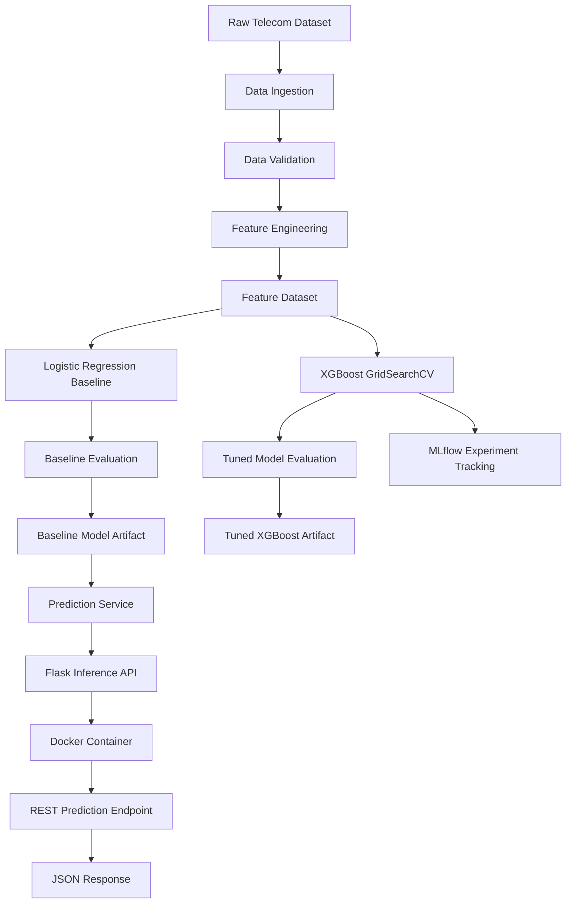

# 📉 Customer Churn Prediction Platform

A production-style machine learning platform for telecom churn prediction that demonstrates an end-to-end ML engineering workflow—from data ingestion and feature engineering through model training, experiment tracking, API inference, containerization, automated testing, and continuous integration.

---

## 📌 Overview

Customer churn prediction is a common business problem in subscription-based industries. Identifying customers who are likely to leave can help organizations prioritize retention efforts and better allocate customer-success resources.

This project approaches that problem as an **ML engineering system**, not just a modeling notebook. It implements modular pipelines and deployment-oriented components around the machine learning workflow.

The system includes:

- Data ingestion and validation
- Feature engineering
- Logistic Regression baseline training
- Model evaluation
- XGBoost hyperparameter tuning with `GridSearchCV`
- MLflow experiment tracking
- Persisted model and reporting artifacts
- Flask REST API inference
- RESTful JSON endpoints
- Docker containerization
- Automated testing with `pytest`
- Continuous Integration with GitHub Actions

The emphasis is on **reproducibility, modularity, testability, and deployable ML services**.

---

## 🎯 Business Problem

Customer churn directly affects recurring revenue, acquisition costs, and customer lifetime value.

A churn prediction system can help a business:

- Identify customers with elevated churn risk
- Prioritize retention campaigns
- Support customer-success decision making
- Integrate predictive scores into downstream applications
- Establish a repeatable workflow for retraining and evaluating churn models

This project demonstrates the engineering foundation required to move a predictive model beyond exploratory analysis and toward an operational service.

---

## ✨ Key Features

### 🔄 Modular ML Pipeline

The project separates the machine learning lifecycle into dedicated components for:

- Data ingestion
- Data validation
- Feature engineering
- Model training
- Model evaluation
- Hyperparameter tuning
- Experiment tracking
- Prediction serving

This separation of concerns makes individual stages easier to test, maintain, and extend.

### 🧠 Baseline Model Training

The baseline training pipeline uses **Logistic Regression** inside a Scikit-learn pipeline with median-value imputation.

The workflow:

1. Loads the engineered feature dataset
2. Separates features and the churn target
3. Creates a stratified train/test split
4. Fits the model pipeline
5. Generates predictions
6. Calculates classification metrics
7. Persists the trained model
8. Writes training metrics to disk

### 🔬 XGBoost Hyperparameter Tuning

An additional model-development workflow trains and tunes an **XGBoost classifier** using `GridSearchCV`.

The tuning pipeline supports:

- Configurable XGBoost parameters
- Cross-validation
- Configurable scoring
- Best-parameter selection
- Test-set evaluation
- Tuned-model persistence
- Tuning-summary generation

This provides a more advanced candidate model alongside the Logistic Regression baseline.

### 📊 MLflow Experiment Tracking

MLflow is used to track the XGBoost tuning workflow.

Tracked information includes:

- Model type
- Cross-validation configuration
- Scoring configuration
- Best hyperparameters
- Evaluation metrics
- Best cross-validation score
- MLflow run ID
- Logged model artifact

The current implementation uses a local file-based MLflow tracking store.

### ⚡ Flask Inference Service

The project exposes model inference through a Flask REST service.

The `/predict` endpoint:

- Accepts engineered feature inputs
- Loads the persisted baseline model
- Generates a churn classification
- Calculates positive-class probability when supported
- Returns a structured JSON prediction response

The API provides clean RESTful endpoints for integration with other services.

### 🐳 Containerized Runtime

The API can run inside a Docker container using Python 3.11 and Flask development server.

Docker Compose provides a convenient local container workflow with:

- Image build configuration
- Port mapping
- Application volume mapping
- Restart behavior

### 🧪 Automated Testing

The test suite covers core ML pipeline functionality, including:

- Data ingestion
- Feature engineering
- Model training
- Evaluation behavior

Current verified baseline:

```text
13 passed
```

### 🔁 Continuous Integration

GitHub Actions runs automated validation on pushes and pull requests targeting `main`.

The CI workflow:

1. Checks out the repository
2. Configures Python 3.11
3. Installs project dependencies
4. Runs the pytest suite

---

## 🏗️ System Architecture



> **Current serving behavior:** the Flask prediction service loads the persisted Logistic Regression baseline model. The tuned XGBoost model is produced and persisted separately as a model-development artifact.

---

## 🛠️ Tech Stack

| Category               | Technology             |
| ---------------------- | ---------------------- |
| Language               | Python 3.11            |
| Data Processing        | Pandas                 |
| Machine Learning       | Scikit-learn, XGBoost  |
| Hyperparameter Tuning  | GridSearchCV           |
| Experiment Tracking    | MLflow                 |
| Model Persistence      | Joblib                 |
| API                    | Flask                  |
| API Server             | Flask Dev Server       |
| Containerization       | Docker, Docker Compose |
| Testing                | pytest                 |
| Continuous Integration | GitHub Actions         |

---

## 📁 Project Structure

```text
customer-churn-prediction-platform/
│
├── api/
│   ├── main.py
│   └── schemas.py
│
├── src/
│   ├── ingestion/
│   │   ├── load_data.py
│   │   ├── run_ingestion.py
│   │   └── validate_data.py
│   │
│   ├── features/
│   │   └── build_features.py
│   │
│   ├── training/
│   │   ├── train.py
│   │   ├── evaluate.py
│   │   └── tune.py
│   │
│   ├── serving/
│   │   └── predict.py
│   │
│   ├── registry/
│   │   └── mlflow_registry.py
│   │
│   ├── monitoring/
│   │   └── monitor.py
│   │
│   └── utils/
│
├── configs/
│   ├── paths.yaml
│   └── training.yaml
│
├── artifacts/
│   ├── models/
│   ├── reports/
│   └── figures/
│
├── tests/
│
├── .github/
│   └── workflows/
│       └── ci.yml
│
├── Dockerfile
├── docker-compose.yml
├── requirements.txt
├── pyproject.toml
└── README.md
```

---

## 🚀 Running the Project

### 💻 Option 1 — Run Locally

Install dependencies:

```powershell
pip install -r requirements.txt
```

Run the baseline training pipeline:

```powershell
python -m src.training.train
```

Start the API:

```powershell
python -m flask --app api.main run
```

Access the API endpoint:

```text
http://localhost:5000/predict
```

### 🐳 Option 2 — Run with Docker

Build the container:

```powershell
docker compose build
```

Start the service:

```powershell
docker compose up
```

Access the API endpoint:

```text
http://localhost:5000/predict
```

---

## 🔬 Model Development

### 📈 Baseline Model

The primary baseline is:

```text
Logistic Regression
```

The model is trained inside a Scikit-learn pipeline with median-value imputation and persisted as a Joblib artifact.

### 🚀 Tuned Candidate Model

The advanced model-development workflow uses:

```text
XGBoost + GridSearchCV
```

The tuning process performs cross-validation, identifies the best hyperparameters, evaluates the resulting estimator against the held-out test set, and persists the tuned model.

### 📊 Experiment Tracking

MLflow records the XGBoost tuning experiment, including:

- Model parameters
- Best hyperparameters
- Evaluation metrics
- Best cross-validation score
- Model artifact
- Run identifier

The project currently uses MLflow for **experiment tracking**. A full production Model Registry promotion workflow is a potential future extension.

---

## ⚡ API Example

### 📤 Request

**Endpoint**

```text
POST /predict
```

Example request:

```json
{
  "features": {
    "SeniorCitizen": 0,
    "tenure": 1,
    "MonthlyCharges": 29.85,
    "TotalCharges": 29.85
  }
}
```

### 📥 Response

Example response structure:

```json
{
  "prediction": 1,
  "prediction_label": "Yes",
  "churn_probability": 0.61
}
```

> The values above illustrate the API response format. Actual predictions depend on the trained model artifact and supplied feature values.

---

## 🧪 Testing

Run the test suite with:

```powershell
python -m pytest
```

Current verified result:

```text
13 passed
```

The current suite validates core functionality across:

- Ingestion
- Feature engineering
- Model training
- Evaluation

Additional API, serving, monitoring, and end-to-end tests are natural extensions toward a more comprehensive production test strategy.

---

## 🔁 Continuous Integration

The repository includes a GitHub Actions workflow that automatically runs the test suite for:

- Pushes to `main`
- Pull requests targeting `main`

This provides automated regression checking as the codebase evolves.

---

## ✅ Implementation Status

| Capability                         | Status              |
| ---------------------------------- | ------------------- |
| Data ingestion                     | ✅ Implemented      |
| Data validation                    | ✅ Implemented      |
| Feature engineering                | ✅ Implemented      |
| Logistic Regression baseline       | ✅ Implemented      |
| Model evaluation                   | ✅ Implemented      |
| XGBoost tuning                     | ✅ Implemented      |
| MLflow experiment tracking         | ✅ Implemented      |
| Model artifact persistence         | ✅ Implemented      |
| Flask REST API inference           | ✅ Implemented      |
| RESTful JSON endpoints             | ✅ Implemented      |
| Docker containerization            | ✅ Implemented      |
| Docker Compose workflow            | ✅ Implemented      |
| Automated pytest suite             | ✅ Implemented      |
| GitHub Actions CI                  | ✅ Implemented      |
| Production model registry workflow | 🔭 Future extension |
| Model/data drift monitoring        | 🔭 Future extension |
| Cloud deployment                   | 🔭 Future extension |
| Continuous deployment              | 🔭 Future extension |

---

## 🧠 Engineering Decisions

### Separate Pipeline Stages

Ingestion, feature engineering, training, tuning, experiment tracking, and serving are implemented as separate modules rather than a single monolithic script.

This keeps responsibilities clear and makes individual stages easier to test and evolve.

### Establish a Baseline Before Tuning

Logistic Regression provides an interpretable baseline before introducing the more complex XGBoost candidate model.

This creates a meaningful reference point for model-development experiments.

### Persist Reproducible Artifacts

Models, reports, and tuning outputs are written to explicit artifact locations rather than existing only in memory or notebook sessions.

### Track Experiments Explicitly

MLflow captures tuning parameters and metrics so model-development decisions can be traced back to individual experiment runs.

### Separate Model Development from Serving

The tuned XGBoost workflow is intentionally distinct from the currently served baseline artifact.

This makes the difference between **model experimentation** and **deployed inference behavior** explicit rather than silently switching the production-facing model.

---

## 🔭 Potential Extensions

The current implementation is intentionally positioned as a **production-style ML engineering platform**. Natural extensions toward a production-ready deployment include:

- MLflow Model Registry integration and model promotion
- Champion/challenger model selection
- API startup-time model loading and readiness checks
- Expanded API and integration testing
- Structured inference logging
- Model and data drift detection
- Prediction-performance monitoring when ground truth becomes available
- Docker image hardening and health checks
- Cloud deployment
- Continuous deployment and rollback automation
- Authentication and rate limiting for externally exposed inference

These capabilities are deliberately presented as future work rather than as functionality already implemented.

---

## 💼 What This Project Demonstrates

This project demonstrates practical skills relevant to **Machine Learning Engineering and MLOps**, including:

- Designing modular ML pipelines
- Building reproducible training workflows
- Establishing and evaluating baseline models
- Performing cross-validated hyperparameter tuning
- Tracking experiments with MLflow
- Persisting machine learning artifacts
- Serving trained models through REST APIs
- Building Flask inference services
- Containerizing ML applications
- Writing automated tests
- Implementing CI with GitHub Actions
- Separating experimentation concerns from inference concerns

Together, these components demonstrate how a machine learning model can be developed as part of a broader **software engineering system rather than as an isolated notebook experiment**.

---

## 👤 Author

**Darrell Mortalla**

AI / Machine Learning Engineering Portfolio

GitHub: [github.com/dmortalla](https://github.com/dmortalla)

---
